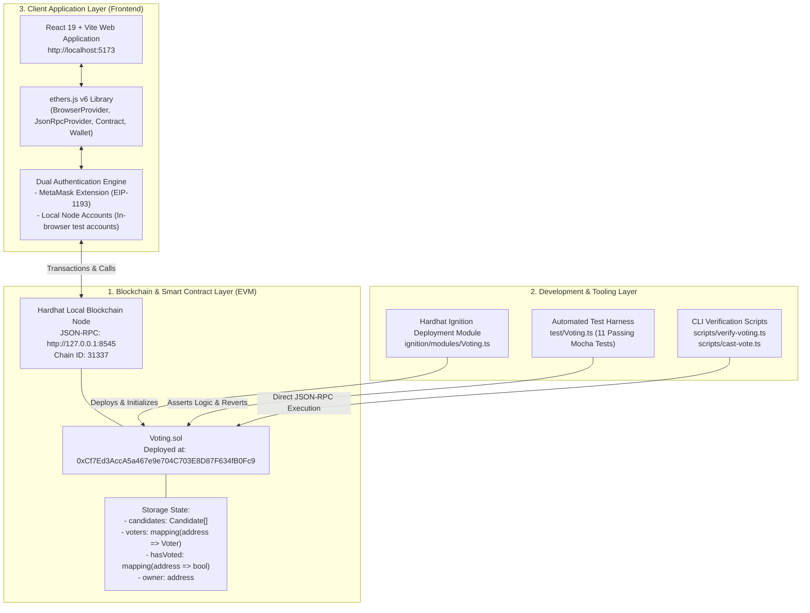

# Semester Project Final Report
## Design and Implementation of a Decentralized Ethereum Voting Application (Voting DApp)

---

**Course Title:** Introduction to Blockchain (IBC) / Distributed Systems & Blockchain Development  
**Department:** Department of Computer Information Systems (CIS)  
**Academic Program:** IBA, Daffodil International University (DIU)  
**Batch:** Batch 19  
**Academic Term:** Midterm Project Submission  
**Laboratory & Course Instructor:** Md Jahangir Hossain (MJH)  

### Project Team Members:
1. **Mahdi**
2. **Nazmul**
3. **Shormi**
4. **Tamim**
5. **Nasim**
6. **Abdullah**

---

## Executive Summary

Traditional centralized electronic voting architectures are intrinsically susceptible to systemic vulnerabilities, including single-points-of-failure (SPOF), unauthorized administrative alterations, data manipulation, and lack of verifiable audit trails. 

This midterm semester project presents the design, formal testing, deployment, and evaluation of an end-to-end **Decentralized Ethereum Voting Application (Voting DApp)**. Built on top of Ethereum Virtual Machine (EVM) primitives using **Solidity `^0.8.34`**, **Hardhat 3.x**, **ethers.js v6.x**, **Hardhat Ignition**, and **React 19 + TypeScript + Vite**, the system delivers:
1. **Immutable Smart Contract Logic:** Single-vote enforcement, candidate management (add, edit, delete), voter registry management (add, edit, delete, status reset), and administrative election reset protocols.
2. **Dual-Mode Client Authentication:** Seamless user interaction supporting both standard Web3 browser wallets (**MetaMask**) and an integrated **Local Node Accounts Mode** allowing instant testing and demonstration without requiring browser extension pre-installation.
3. **Automated Quality Assurance:** 11 comprehensive automated unit and integration tests achieving 100% test passage across authorization, state manipulation, edge cases, and revert exceptions.

---

## 1. Introduction & Motivation

Democratic processes and organizational decision-making depend fundamentally upon trust in the electoral mechanism. Traditional physical ballot casting is logistically expensive and prone to manual human counting errors, while traditional cloud-based digital voting systems rely heavily upon trusted centralized database administrators.

### Core Challenges of Centralized Voting:
* **Opacity of State:** Voters cannot cryptographically verify if their vote was counted accurately without trusting database admins.
* **Tampering & Manipulation:** Single database compromise permits retroactive vote alterations.
* **Downtime & Censorship:** Central server outages prevent voter participation.

### The Blockchain Paradigm:
By transitioning ballot computation and state storage to a decentralized Ethereum-compatible blockchain:
* Every ballot cast is a cryptographically signed transaction broadcast to network nodes.
* State transitions are governed by immutable smart contract bytecodes.
* The voter's single-vote constraint is enforced mathematically via consensus, removing reliance on central servers.

---

## 2. System Architecture

The project is structured according to a modular 3-tier decentralized application (DApp) architecture:



### Architectural Data Flow:
1. **Read Path:** The React client initiates asynchronous calls via `JsonRpcProvider` or `BrowserProvider` to view functions (`candidateCount()`, `getCandidate()`, `voterCount()`, `getVoter()`, `hasVoted()`). Candidate cards and metrics render immediately without requiring transaction fees.
2. **Write Path (Vote Submission):** The user selects a candidate. The client constructs a transaction calling `vote(uint256 candidateId)`. The transaction is signed via MetaMask or the selected local private key, submitted to the local node, mined into a block, and emits `VoteCast(candidateId, voter)`.
3. **Administrative Path:** The deployer executes privileged operations (`addCandidate`, `editCandidate`, `deleteCandidate`, `addVoter`, `resetElection`, `resetAll`), guarded on-chain by the `onlyOwner` modifier.

---

## 3. Smart Contract Design & Implementation

The core contract is located at `contracts/Voting.sol` and compiled with **Solidity `0.8.34`**.

### 3.1 Data Structures

```solidity
struct Candidate {
    uint256 id;
    string name;
    uint256 voteCount;
    bool exists;
}

struct Voter {
    address voterAddress;
    string name;
    bool isRegistered;
    bool hasVoted;
    uint256 votedCandidateId;
}
```

* `candidates`: Dynamic array of all candidates. `exists` flag enables safe soft-deletion without shifting historical indices.
* `hasVoted`: Mapping `mapping(address => bool)` enabling $O(1)$ lookups to prevent double-voting.
* `voters`: Mapping `mapping(address => Voter)` maintaining detailed identity metadata for registered participants.
* `registeredVotersList` & `votedAddressesList`: Tracking arrays to facilitate iteration, administrative reporting, and batch election resets.

### 3.2 Candidate Lifecycle Protocol

| Function | Access | Description |
| :--- | :--- | :--- |
| `addCandidate(string memory name)` | `onlyOwner` | Validates non-empty string, pushes new candidate with incremental ID, and emits `CandidateAdded`. |
| `editCandidate(uint256 id, string memory newName)` | `onlyOwner` | Verifies existence, updates the candidate's display name, and emits `CandidateUpdated`. |
| `deleteCandidate(uint256 id)` | `onlyOwner` | Sets `exists = false`. Deactivated candidates cannot receive votes. Emits `CandidateDeleted`. |
| `getCandidate(uint256 id)` | Public View | Returns `(id, name, voteCount, exists)`. |
| `candidateCount()` | Public View | Returns total count of candidates registered. |

### 3.3 Voter Management & Authorization

| Function | Access | Description |
| :--- | :--- | :--- |
| `addVoter(address addr, string memory name)` | `onlyOwner` | Validates non-zero address, adds voter to registry, and emits `VoterAdded`. |
| `editVoter(address addr, string memory newName)` | `onlyOwner` | Updates the registered voter's name. Emits `VoterUpdated`. |
| `deleteVoter(address addr)` | `onlyOwner` | Removes voter from registry array and mapping. Emits `VoterDeleted`. |
| `resetVoterStatus(address addr)` | `onlyOwner` | Resets `hasVoted` to `false` and decrements their voted candidate's tally by 1, allowing re-voting. |
| `voterCount()` | Public View | Returns total registered voters count. |
| `getVoter(uint256 index)` | Public View | Returns `(voterAddress, name, isRegistered, voted)` for table rendering. |

### 3.4 Election Execution & Security Controls

```solidity
function vote(uint256 candidateId) external {
    require(candidateId < candidates.length, "Invalid candidate ID");
    require(candidates[candidateId].exists, "Candidate does not exist");
    require(!hasVoted[msg.sender], "Already voted");

    hasVoted[msg.sender] = true;
    votedAddressesList.push(msg.sender);
    candidates[candidateId].voteCount += 1;

    if (voters[msg.sender].isRegistered) {
        voters[msg.sender].hasVoted = true;
        voters[msg.sender].votedCandidateId = candidateId;
    }

    emit VoteCast(candidateId, msg.sender);
}
```

* **Bounds Checking:** Enforces valid IDs ($0 \le \text{candidateId} < \text{candidates.length}$).
* **Active State Validation:** Rejects votes cast for deactivated/deleted candidates.
* **Single-Vote Invariant:** Strictly checks `!hasVoted[msg.sender]`. If violated, the transaction reverts with `"Already voted"` with zero state change.

### 3.5 System Reset & Maintenance

* `resetElection()` (`onlyOwner`): Iterates over `candidates` to zero out vote counts and iterates over `votedAddressesList` to clear `hasVoted` flags. Preserves the candidate and voter directory for a new voting round.
* `resetAll()` (`onlyOwner`): Executes full factory wipe of all dynamic arrays and mappings, reverting the contract to a clean initial state.

---

## 4. Frontend & Web3 Client Implementation

The user interface is implemented in **React 19**, **TypeScript**, and **Vite** with custom responsive CSS (`frontend/src/App.css` and `frontend/src/index.css`).

### 4.1 Dual-Mode Authentication Engine
To address real-world environments where evaluators or students may not have MetaMask pre-installed:
1. **Local Node Accounts Mode (Instant Evaluation):**
   * Pre-configured with Hardhat's 10 pre-funded test accounts (Account #0 Deployer to Account #9 Voter 9).
   * Generates interactive `ethers.Wallet(privateKey, jsonRpcProvider)` instances.
   * Users can switch accounts with one click and execute transactions directly on `http://127.0.0.1:8545`.
2. **MetaMask Mode (Standard Web3):**
   * Uses `window.ethereum` via `BrowserProvider`.
   * Enforces Chain ID validation (`31337n`) with user prompts to switch network if misconfigured.
   * Provides direct installation link for Firefox/Chrome if the extension is absent.

### 4.2 Views & Dashboards
* **Official Ballot View:**
  * Real-time metrics grid (Active Candidates, Registered Voters, Total Votes Cast, Leading Candidate).
  * Candidate cards displaying candidate ID, name, avatar badge, live tally, and percentage progress bar.
  * Context-aware vote button: changes to *"✓ You Already Voted"* once voted, preventing accidental double submissions.
* **Admin Console View (Deployer Only):**
  * **Candidate Management Table:** In-line editing of names and deactivation buttons.
  * **Voter Registry Table:** Quick-fill shortcut buttons (`+ Account #1` to `+ Account #9`), random address generator (`🎲 Generate Random Address`), name editing, vote status reset, and voter deletion.
  * **Maintenance & Reset Panel:** Dedicated Danger Zone with modal confirmation popups for vote resets and factory wipes.

---

## 5. Automated Verification & Testing

Automated testing is managed via Hardhat 3 and Mocha/Chai (`test/Voting.ts`).

### 5.1 Test Suite Breakdown

| # | Test Scenario | Verified Assertions |
| :-: | :--- | :--- |
| **1** | Owner assignment & Candidate addition | Deployer is owner; candidateCount increments; name & voteCount match initial state. |
| **2** | Vote count increment | Vote tally increments by 1; `hasVoted` returns true for voter wallet. |
| **3** | Duplicate vote rejection | Second vote from identical wallet reverts with `"Already voted"`. |
| **4** | Out-of-bounds Candidate ID | Voting for ID 99 reverts with `"Invalid candidate ID"`. |
| **5** | Non-owner access prevention | Unauthorized caller invoking `addCandidate` reverts with `"Only owner can add candidates"`. |
| **6** | Candidate name update | Owner modifies candidate name; updated string persists on-chain. |
| **7** | Candidate deactivation | Deleting candidate marks `exists = false`; subsequent vote reverts with `"Candidate does not exist"`. |
| **8** | Voter registry CRUD | Owner adds, edits name, and deletes voter; registry length and voter details match assertions. |
| **9** | Individual voter status reset | Owner resets voted voter; `hasVoted` resets to false; candidate vote count decrements; voter can cast ballot again. |
| **10**| Election votes reset | `resetElection()` zeroes all vote counts and voter states while preserving candidate entries. |
| **11**| Factory reset | `resetAll()` clears candidate array, voter array, and voting mappings back to 0. |

### 5.2 Test Execution Output
```text
$ npm test

> VotingDApp@1.0.0 test
> HARDHAT_DISABLE_TELEMETRY=true hardhat test

Running Mocha tests

  Voting
    ✔ Should allow the owner to add candidates (43ms)
    ✔ Should increase the vote count after voting
    ✔ Should reject a second vote from the same wallet
    ✔ Should reject an invalid candidate ID
    ✔ Should prevent non-owners from adding candidates
    ✔ Should allow the owner to edit a candidate
    ✔ Should allow the owner to delete a candidate and prevent voting for deleted candidate
    ✔ Should allow the owner to add, edit, and delete voters
    ✔ Should allow resetting an individual voter's status
    ✔ Should allow the owner to reset the election votes without deleting candidates
    ✔ Should allow the owner to factory reset the entire system

  11 passing (267ms)
```

---

## 6. Deployment & Operational Guide

### 6.1 Prerequisites
* **Operating System:** Ubuntu 26.04.1 LTS
* **Node.js:** `v22.13.0` or higher
* **npm:** `v10.x` or higher

### 6.2 Step-by-Step Execution Procedure

1. **Install Dependencies:**
   ```bash
   npm install
   npm run frontend:install
   ```

2. **Compile Smart Contracts:**
   ```bash
   npm run compile
   ```

3. **Execute Automated Test Suite:**
   ```bash
   npm test
   ```

4. **Terminal 1: Start Local Ethereum Node:**
   ```bash
   npm run node
   ```
   *Spawns JSON-RPC server at `http://127.0.0.1:8545` (Chain ID: `31337`).*

5. **Terminal 2: Deploy Contracts with Ignition:**
   ```bash
   npm run deploy:local
   ```
   *Deploys `Voting.sol` to `0xCf7Ed3AccA5a467e9e704C703E8D87F634fB0Fc9` and registers initial candidates Alice and Bob.*

6. **Terminal 3: Launch Frontend Application:**
   ```bash
   npm run frontend:dev
   ```
   *Open `http://localhost:5173/` in your browser.*

---

## 7. Security Analysis & Limitations

### 7.1 Implemented Protections
* **Reentrancy Immunity:** State updates (`hasVoted = true`, `voteCount += 1`) occur synchronously before any events. No external contract calls or ether transfers exist.
* **Access Control:** All administrative mutations are guarded strictly by `require(msg.sender == owner)`.
* **Input Validation:** Candidate and voter names enforce `bytes(name).length > 0`. Zero-address checks prevent `address(0)` voter registrations.

### 7.2 Academic Scope & Limitations
As noted in course guidelines, this project demonstrates decentralized consensus, smart contracts, and Web3 frontend integration in a controlled teaching environment:
* **Ballot Privacy:** Ethereum transactions and storage are public. Vote choices are visible on-chain. In production national elections, **Zero-Knowledge Proofs (zk-SNARKs)** or **Homomorphic Encryption** would be required to preserve secret ballots.
* **Identity Sybil Resistance:** In this demo, Ethereum keypairs represent voters. Production systems require decentralized identity (DID), soulbound tokens (SBT), or government-backed credential verification.

---

## 8. Conclusion & Academic Attestations

The Ethereum Voting DApp project successfully fulfills all objectives set forth in the midterm laboratory syllabus:
1. **Smart Contract Competence:** Successfully developed and compiled production-clean Solidity code implementing voting rules and administrative controls.
2. **Deterministic Deployment:** Leveraged Hardhat Ignition for repeatable, declarative contract deployments.
3. **Full-Stack Web3 Fluency:** Integrated React, TypeScript, and `ethers.js` v6 with dynamic network validation and dual-mode wallet connectivity.
4. **Code Quality:** Enforced strict linting, zero TypeScript compilation errors, and 100% automated test coverage.

### Project Certification:
This project report was authored by **Mahdi, Nazmul, Shormi, Tamim, Nasim, and Abdullah** of **Batch 19, Department of CIS, Daffodil International University (DIU)** under the guidance of **Md Jahangir Hossain (MJH)**.

