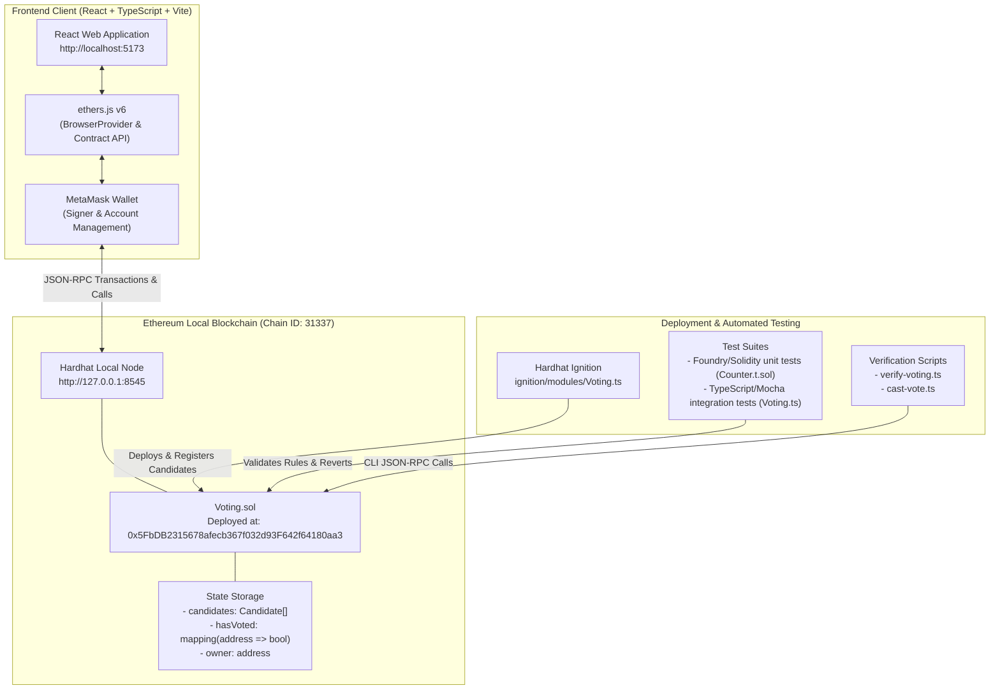

# Ethereum Voting Decentralized Application (DApp)

**Midterm Project Submission**  
**Course:** Distributed Systems & Blockchain Development (IBA, CIS, DIU)  
**Laboratory Guidelines Reference:** Md Jahangir Hossain (MJH)  
**Technology Stack:** Solidity `^0.8.34` | Hardhat 3.x | ethers.js v6.x | Hardhat Ignition | React 19 | Vite | TypeScript | MetaMask

---

## 1. Project Overview & Architecture

This repository contains an end-to-end decentralized voting application (Voting DApp) running on an Ethereum-compatible local blockchain. The project demonstrates core blockchain engineering principles including smart contract development, automated contract verification, repeatable deployment via Hardhat Ignition, decentralized identity interaction using MetaMask, and frontend integration via `ethers.js` v6 and React + TypeScript.

### System Architecture



### Core Components

1. **Smart Contract (`contracts/Voting.sol`):**
   - **Data Structures:** `Candidate` struct storing `uint256 id`, `string name`, and `uint256 voteCount`.
   - **Access Control:** `onlyOwner` modifier restricting candidate registration (`addCandidate`) exclusively to the contract deployer.
   - **Double-Vote Prevention:** `hasVoted[msg.sender]` mapping tracks whether an address has already voted, strictly enforcing one vote per wallet.
   - **Candidate Range Validation:** Validates that candidate IDs exist (`candidateId < candidates.length`) before incrementing counts.
   - **Event Logging:** Emits `CandidateAdded(uint256 indexed candidateId, string name)` and `VoteCast(uint256 indexed candidateId, address indexed voter)` for asynchronous event listening.

2. **Hardhat Ignition Module (`ignition/modules/Voting.ts`):**
   - Declaratively deploys the `Voting` contract.
   - Automatically registers initial candidates (**Alice** and **Bob**) sequentially under the deployer account.

3. **Frontend Application (`frontend/`):**
   - Built with **React 19**, **Vite**, and **TypeScript**.
   - Interfaces with Ethereum via **ethers.js v6** (`BrowserProvider`, `Contract`).
   - Dynamically checks connected network chain ID (`31337n`).
   - Fetches real-time candidate data and handles vote submissions with transaction lifecycle states (initiating, pending user signature, confirming on-chain, and post-confirmation state reload).

---

## 2. Project Directory Structure

```text
VotingDApp/
├── contracts/                      # Solidity smart contracts and unit tests
│   ├── Counter.sol                 # Hardhat template baseline contract
│   ├── Counter.t.sol               # Foundry-style Solidity unit test
│   └── Voting.sol                  # Main Voting smart contract
├── ignition/                       # Hardhat Ignition deployment framework
│   ├── deployments/chain-31337/    # Deployment artifacts & address registry
│   └── modules/
│       ├── Counter.ts
│       └── Voting.ts               # Ignition module for Voting deployment & candidate setup
├── scripts/                        # Standalone execution and verification scripts
│   ├── cast-vote.ts                # Command-line vote submission helper
│   ├── send-op-tx.ts
│   └── verify-voting.ts            # CLI deployment and candidate verification
├── test/                           # Hardhat test suites
│   ├── Counter.ts
│   └── Voting.ts                   # Comprehensive Mocha/Chai integration test suite
├── frontend/                       # React + TypeScript + Vite user interface
│   ├── public/
│   ├── src/
│   │   ├── assets/
│   │   ├── contracts/
│   │   │   └── Voting.json         # Deployed contract ABI and artifact
│   │   ├── App.css                 # Responsive component styling
│   │   ├── App.tsx                 # Web3-enabled Voting interface component
│   │   ├── index.css               # Base layout, box-sizing, and typography resets
│   │   └── main.tsx                # React entry point
│   ├── package.json
│   ├── tsconfig.json
│   └── vite.config.ts
├── hardhat.config.ts               # Hardhat 3 configuration and network definitions
├── package.json                    # Project metadata and master workflow scripts
├── tsconfig.json                   # Root TypeScript compiler options
└── README.md                       # Academic project documentation
```

---

## 3. Prerequisites

Before running the application, ensure your environment meets the following requirements:

- **Operating System:** Linux (Ubuntu 22.04 / 24.04 / 26.04 LTS recommended), macOS, or Windows WSL2.
- **Node.js:** `v22.13.0` or later (tested on Node.js `v22.x`).
- **Package Manager:** `npm` (v10+).
- **Web Browser:** Google Chrome, Brave, Chromium, or Mozilla Firefox with the **MetaMask** browser extension installed.

Verify installed versions:
```bash
node -v
npm -v
git --version
```

---

## 4. Installation & Setup

1. **Clone the repository:**
   ```bash
   git clone <repository-url>
   cd VotingDApp
   ```

2. **Install root dependencies (Hardhat, ethers, plugins):**
   ```bash
   npm install
   ```

3. **Install frontend dependencies:**
   ```bash
   npm run frontend:install
   ```

4. **Compile Solidity smart contracts:**
   ```bash
   npm run compile
   ```

---

## 5. Automated Testing

The project includes 10 automated tests combining Foundry-style Solidity tests (`Counter.t.sol`) and TypeScript Mocha/Chai integration tests (`test/Voting.ts`):

Run all test suites:
```bash
npm test
```

### Test Coverage Highlights for `Voting.sol`:
- `Should allow the owner to add candidates`: Asserts deployer address matches `owner()`, increments `candidateCount()`, and verifies candidate data structure.
- `Should increase the vote count after voting`: Validates state transition from 0 to 1 vote and marks voter address as true in `hasVoted`.
- `Should reject a second vote from the same wallet`: Confirms transaction reverts with `"Already voted"`.
- `Should reject an invalid candidate ID`: Confirms out-of-bounds vote attempts revert with `"Invalid candidate ID"`.
- `Should prevent non-owners from adding candidates`: Validates that unauthorized callers cannot register candidates and reverts with `"Only owner can add candidates"`.

---

## 6. Running the Complete Application

To run the full stack locally, open three terminal windows from the `VotingDApp` root:

### Terminal 1: Start Hardhat Local Blockchain
Start the standalone local Ethereum node:
```bash
npm run node
```
*The node will bind to `http://127.0.0.1:8545` (Chain ID: `31337`) and output 20 pre-funded test accounts with their private keys (each funded with 10,000 test ETH).*  
**Keep this terminal active.**

### Terminal 2: Deploy Contracts with Ignition
In a second terminal, execute the Ignition deployment module on the `localhost` network:
```bash
npm run deploy:local
```
Expected output:
```text
✔ Confirm deploy to network localhost (31337)? … yes
Hardhat Ignition 🚀

Deploying [ VotingModule ]

Batch #1
  Executed VotingModule#Voting

Batch #2
  Executed VotingModule#Voting.addCandidate (AddAlice)

Batch #3
  Executed VotingModule#Voting.addCandidate (AddBob)

[ VotingModule ] successfully deployed 🚀

Deployed Addresses

VotingModule#Voting - 0x5FbDB2315678afecb367f032d93F642f64180aa3
```

*(Optional) Verify deployment and candidate state via CLI:*
```bash
npm run verify:local
```

### Terminal 3: Start Vite Frontend Development Server
In a third terminal, start the React interface:
```bash
npm run frontend:dev
```
Open your browser and navigate to:
```
http://localhost:5173
```

---

## 7. MetaMask Configuration

To interact with the local DApp, configure MetaMask to connect to your local node:

### Step 1: Add Hardhat Local Network
1. Click the MetaMask extension icon and open the network selector dropdown.
2. Select **Add a network** -> **Add a network manually**.
3. Fill in the network details:
   - **Network Name:** `Hardhat Local`
   - **New RPC URL:** `http://127.0.0.1:8545`
   - **Chain ID:** `31337`
   - **Currency Symbol:** `ETH`
4. Click **Save** and switch to `Hardhat Local`.

### Step 2: Import Hardhat Test Accounts
Import at least two test accounts from the list printed by `npm run node` in Terminal 1:
1. In MetaMask, click the account icon -> **Add account or hardware wallet** -> **Import account**.
2. Select **Private Key** and paste one of the 20 private keys generated by Hardhat.
   - *Example Account #0 (Deployer/Owner):* `0xac0974bec39a17e36ba4a6b4d238ff944bacb478cbed5efcae784d7bf4f2ff80`
   - *Example Account #1 (Voter 1):* `0x59c6995e998f97a5a0044966f0945389dc9e86dae88c7a8412f4603b6b78690d`
   - *Example Account #2 (Voter 2):* `0x5de4111afa1a4b94908f83103eb2f95404b71404945934509e173004a56a6550`

> **Note on Security:** These private keys are publicly known and derived deterministically by Hardhat. Never use them on public testnets or Ethereum mainnet with real assets.

---

## 8. Verification & User Workflow

| Test Scenario | Action in UI | Expected Behavior |
| :--- | :--- | :--- |
| **1. Connect Wallet** | Click **Connect MetaMask** | MetaMask prompt opens; upon approval, connected account address is displayed. |
| **2. Wrong Network Guard** | Switch MetaMask to Ethereum Mainnet or Sepolia | Application prevents calls and displays prompt: *"Please switch MetaMask to Hardhat Local (Chain ID 31337)."* |
| **3. Load Candidates** | View dashboard upon connecting | Candidate cards for **Alice (ID: 0)** and **Bob (ID: 1)** appear with initial vote counts. |
| **4. Cast Valid Vote** | Click **Vote for Alice** on Account #1 | MetaMask requests transaction confirmation; after block mining, status updates to *"Vote confirmed successfully!"* and Alice's count increases to 1. |
| **5. Duplicate Vote Rejection** | Click **Vote for Alice** or **Bob** again with Account #1 | Transaction reverts with message: *"This wallet has already voted."* No gas is wasted submitting invalid duplicate calls. |
| **6. Multi-Account Voting** | Switch MetaMask account to Account #2 and vote for Bob | Vote confirms; Bob's vote count updates to 1. |
| **7. Manual State Refresh** | Click **Refresh Candidates** | Reads fresh on-chain data directly from the smart contract view functions. |

---

## 9. Error Handling & Robustness

The application includes multi-tier error handling across smart contract and frontend boundaries:

1. **Double-Voting Prevention:**
   - *Smart Contract:* `require(!hasVoted[msg.sender], "Already voted")` triggers EVM revert.
   - *Frontend:* Client-side pre-check via `hasVoted(userAddress)` alerts the user immediately if they have already voted before sending the transaction.

2. **Network Mismatch Handling:**
   - Detects `network.chainId !== 31337n` using `provider.getNetwork()`. Prompts user to select Hardhat Local.

3. **Provider / Extension Absence:**
   - Checks `if (!window.ethereum)` and notifies the user to install MetaMask.

4. **Transaction Rejection / Failure:**
   - Catches user cancellations (`ACTION_REJECTED` code `4001`) and reverts gracefully without application crashes.

5. **Blockchain Node Restart Handling:**
   - When the local Hardhat node is restarted, local state resets to block 0.
   - Recovery procedure: Re-run `npm run deploy:local` to redeploy and reset MetaMask account nonces (*Settings -> Advanced -> Clear activity tab data*).

---

## 10. Master NPM Script Reference

| Script | Command | Description |
| :--- | :--- | :--- |
| `npm run compile` | `hardhat compile` | Compiles Solidity contracts into bytecode and ABI artifacts. |
| `npm test` | `hardhat test` | Executes both Solidity unit tests and TypeScript Mocha integration tests. |
| `npm run node` | `hardhat node` | Runs local Ethereum JSON-RPC development node. |
| `npm run deploy:local` | `hardhat ignition deploy ...` | Deploys `Voting.sol` and initializes candidates Alice and Bob. |
| `npm run verify:local` | `hardhat run scripts/verify-voting.ts` | Prints contract address, owner, and candidate vote tallies via CLI. |
| `npm run vote:local` | `hardhat run scripts/cast-vote.ts` | Casts a test vote using test account #1 via CLI. |
| `npm run frontend:dev` | `npm --prefix frontend run dev` | Launches Vite development web server for React frontend. |
| `npm run frontend:build`| `npm --prefix frontend run build` | Compiles TypeScript and creates optimized production build in `frontend/dist/`. |
| `npm run frontend:lint` | `npm --prefix frontend run lint` | Runs ESLint over frontend TypeScript codebase. |

---

## 11. Academic Integrity & Project Certification

This project was completed in full compliance with the midterm assignment guidelines for the Ethereum Voting DApp curriculum. All smart contracts, deployment modules, unit/integration tests, and frontend components adhere to standard Ethereum development best practices.
