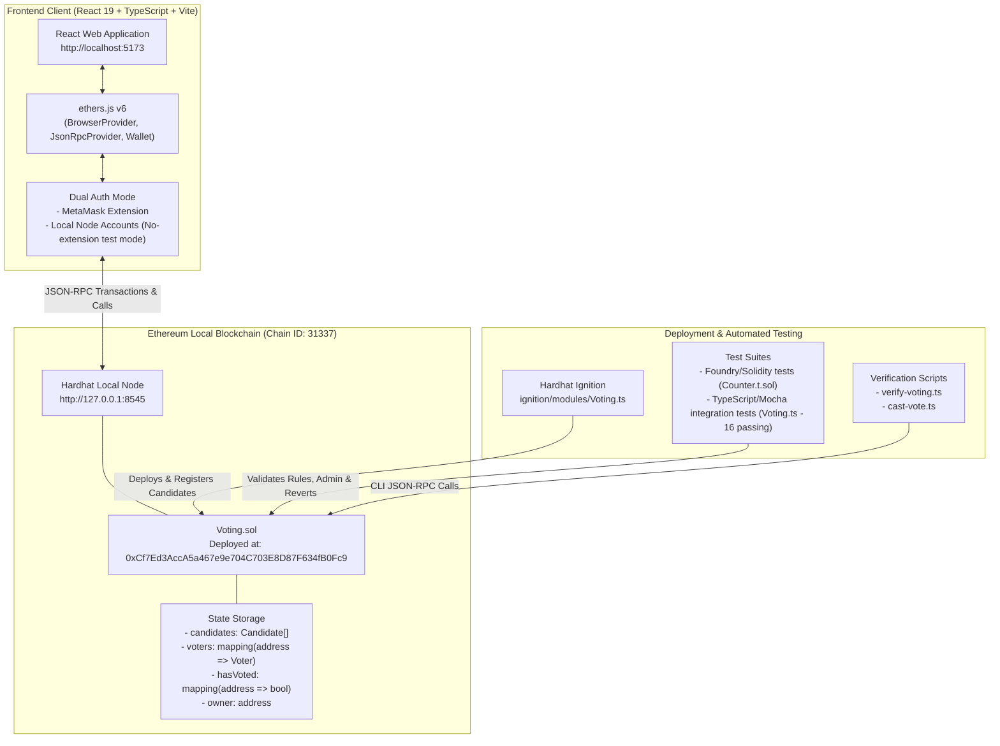

# Ethereum Voting Decentralized Application (DApp)

**Midterm Project Submission**  
**Course:** Distributed Systems & Blockchain Development (IBA, CIS, DIU)  
**Laboratory Guidelines Reference:** Md Jahangir Hossain (MJH)  
**Technology Stack:** Solidity `^0.8.34` | Hardhat 3.x | ethers.js v6.x | Hardhat Ignition | React 19 | Vite | TypeScript | MetaMask

---

## 1. Project Overview & Architecture

This repository contains a full-featured, academic-grade decentralized voting application (Voting DApp) running on an Ethereum local blockchain. The application supports dual-mode authentication (MetaMask or pre-funded local Hardhat test accounts), complete candidate lifecycle management (add, edit, delete), voter registry management (add, edit, delete, reset vote status), and administrative election reset capabilities.

### System Architecture



### Core Features & Capabilities

1. **Candidate Management (Admin Only):**
   - **Add Candidate:** Register new candidates on the blockchain (`addCandidate`).
   - **Edit Candidate:** Update existing candidate names dynamically on-chain (`editCandidate`).
   - **Delete Candidate:** Deactivate candidates from the ballot (`deleteCandidate`).

2. **Voter Management (Admin Only):**
   - **Register Voter:** Add voters to the on-chain registry with name and address (`addVoter`).
   - **Edit Voter:** Update registered voter details (`editVoter`).
   - **Delete Voter:** Unregister voters from the system (`deleteVoter`).
   - **Reset Voter Status:** Reset an individual voter's status and deduct their previous vote so they can re-vote (`resetVoterStatus`).

3. **System Reset & Maintenance (Admin Only):**
   - **Reset Election Votes Only:** Zeroes out all candidate vote tallies and clears voting history while keeping candidates and registered voters intact (`resetElection`).
   - **Full Factory Reset:** Permanently wipes all candidates, voters, and voting records on-chain (`resetAll`).

4. **Dual Authentication Support (With or Without MetaMask):**
   - **MetaMask Mode:** Connects to the browser extension and prompts transaction signatures.
   - **Local Node Accounts Mode:** Allows direct testing with pre-funded Hardhat accounts (Account #0 Deployer/Admin, Account #1 Voter 1, Account #2 Voter 2, etc.) directly in the browser without installing MetaMask!

---

## 2. Project Directory Structure

```text
VotingDApp/
├── contracts/                      # Solidity smart contracts and unit tests
│   ├── Counter.sol                 # Hardhat template baseline contract
│   ├── Counter.t.sol               # Foundry-style Solidity unit test
│   └── Voting.sol                  # Main Voting smart contract (CRUD & Reset)
├── ignition/                       # Hardhat Ignition deployment framework
│   ├── deployments/chain-31337/    # Deployment artifacts & address registry
│   └── modules/
│       ├── Counter.ts
│       └── Voting.ts               # Ignition module for Voting deployment
├── scripts/                        # Standalone execution and verification scripts
│   ├── cast-vote.ts                # Command-line vote submission helper
│   ├── send-op-tx.ts
│   └── verify-voting.ts            # CLI deployment and candidate verification
├── test/                           # Hardhat test suites (16 passing tests)
│   ├── Counter.ts
│   └── Voting.ts                   # Comprehensive Mocha/Chai integration test suite
├── frontend/                       # React + TypeScript + Vite user interface
│   ├── public/
│   ├── src/
│   │   ├── contracts/
│   │   │   └── Voting.json         # Deployed contract ABI and artifact
│   │   ├── App.css                 # Responsive Web3 theme & Admin styles
│   │   ├── App.tsx                 # Web3 Voting & Admin dashboard component
│   │   ├── index.css               # Universal box-sizing and layout reset
│   │   └── main.tsx                # React entry point
│   ├── package.json
│   ├── tsconfig.json
│   └── vite.config.ts
├── hardhat.config.ts               # Hardhat 3 configuration and network definitions
├── package.json                    # Project metadata and master workflow scripts
├── tsconfig.json                   # Root TypeScript compiler options
└── README.md                       # Academic project documentation
```

---

## 3. Automated Testing

The project includes 16 automated tests covering unit logic, candidate CRUD, voter registry CRUD, single-vote enforcement, and system resets:

```bash
npm test
```

### Passing Test Suites Summary:
```text
Running Solidity tests
  contracts/Counter.t.sol:CounterTest
    ✔ test_InitialValue()
    ✔ test_IncByZero()
    ✔ testFuzz_Inc(uint8) (runs: 256)

Running Mocha tests
  Counter
    ✔ Should emit the Increment event when calling the inc() function
    ✔ The sum of the Increment events should match the current value

  Voting
    ✔ Should allow the owner to add candidates
    ✔ Should increase the vote count after voting
    ✔ Should reject a second vote from the same wallet
    ✔ Should reject an invalid candidate ID
    ✔ Should prevent non-owners from adding candidates
    ✔ Should allow the owner to edit a candidate
    ✔ Should allow the owner to delete a candidate and prevent voting for deleted candidate
    ✔ Should allow the owner to add, edit, and delete voters
    ✔ Should allow resetting an individual voter's status
    ✔ Should allow the owner to reset the election votes without deleting candidates
    ✔ Should allow the owner to factory reset the entire system

16 passing (3 solidity, 13 mocha)
```

---

## 4. Running the Complete Application

To run the full stack locally:

### Terminal 1: Start Local Hardhat Blockchain
```bash
npm run node
```
*Binds to `http://127.0.0.1:8545` (Chain ID: `31337`). Keep this terminal running.*

### Terminal 2: Deploy Contracts with Ignition
```bash
npm run deploy:local
```
Deploys `Voting.sol` to `0xCf7Ed3AccA5a467e9e704C703E8D87F634fB0Fc9` and registers initial candidates Alice and Bob.

### Terminal 3: Start Vite Frontend Development Server
```bash
npm run frontend:dev
```
Open **`http://localhost:5173/`** in your browser.

---

## 5. User & Admin Workflow Guide

### Voter Workflow (Official Ballot View):
1. **Choose Account:** In **Local Node Accounts**, choose **Account #1 (Voter 1)** or **Account #2 (Voter 2)**.
2. **Review Candidates:** See live vote tallies, percentage progress bars, and leading candidate badge.
3. **Cast Vote:** Click **Vote for [Candidate]** to record your vote on-chain.
4. **Duplicate Prevention:** Attempting to vote again will be blocked with *"This wallet has already voted."*

### Admin Workflow (Admin Console View):
1. **Switch to Admin Account:** Select **Account #0 (Deployer / Admin)**.
2. **Switch Tab:** Click **👑 Admin Console** in the top navigation bar.
3. **Candidate Management:**
   - Add new candidates by typing a name and clicking **+ Add Candidate**.
   - Edit any candidate's name by clicking **✏️ Edit**.
   - Deactivate candidates by clicking **🗑️ Delete**.
4. **Voter Management:**
   - Register new voters with their wallet address and full name.
   - Edit voter names or delete voters.
   - Click **🔄 Reset Vote** on a voter who has voted to clear their status and allow them to vote again.
5. **System Reset:**
   - **Reset Election Votes:** Resets all votes to zero for a new round without losing candidates.
   - **Factory Reset Entire System:** Clears all candidates, voters, and votes to start completely over.

---

## 6. Master NPM Script Reference

| Script | Command | Description |
| :--- | :--- | :--- |
| `npm run compile` | `hardhat compile` | Compiles Solidity contracts. |
| `npm test` | `hardhat test` | Runs all 16 Solidity and Mocha tests. |
| `npm run node` | `hardhat node` | Starts local Ethereum JSON-RPC node. |
| `npm run deploy:local` | `hardhat ignition deploy ...` | Deploys contract and sets initial candidates. |
| `npm run verify:local` | `hardhat run scripts/verify-voting.ts` | Displays on-chain contract state via CLI. |
| `npm run vote:local` | `hardhat run scripts/cast-vote.ts` | Submits a test vote via CLI. |
| `npm run frontend:dev` | `npm --prefix frontend run dev` | Runs Vite frontend development server. |
| `npm run frontend:build`| `npm --prefix frontend run build` | Compiles TypeScript and builds production assets. |
| `npm run frontend:lint` | `npm --prefix frontend run lint` | Runs ESLint over frontend TypeScript codebase. |
